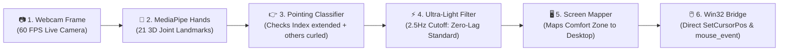
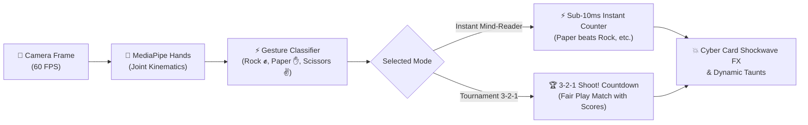

# 🖱️ How CyberMouse PRO Virtual Mouse Works
> **A Complete Guide to AI Optical Hand Pointing & OS Cursor Control**

---

## 🌟 1. The Big Picture: Controlling Your PC with Air Gestures

CyberMouse PRO turns your laptop webcam into a high-precision optical virtual mouse:



---

## 🎯 2. How the Pointing Index Gesture is Recognized

The AI examines your hand's 21 landmarks every frame:
* **Index Fingertip (`Landmark 8`)**: The target tracking point.
* **Extension Check**: The index tip (`8`) must be further from your wrist (`0`) than the knuckle (`5`) and middle joint (`6`).
* **Curl Check**: At least 2 of your other fingers (Middle, Ring, Pinky) must be curled downward.

```
       Pointing Index Tip (Landmark 8) 🎯
                ▲
                │  (Extended)
                │
         [6] Index PIP
                │
         [5] Index MCP
                │          [12] Middle (Curled) ⬇️
                │          [16] Ring (Curled)   ⬇️
                │          [20] Pinky (Curled)  ⬇️
                │
            Wrist (0)
```

When this posture is detected, the cursor locks directly to your index fingertip!

---

## ⚡ 3. The New Ultra-Light Standard Filter

You requested an even lighter filter than before and made it the standard default:

| Filter Preset | Min Cutoff ($f_c$) | Speed Beta ($\beta$) | Latency | Feel |
| :--- | :---: | :---: | :---: | :--- |
| ⚡ **Ultra-Light (Standard)** | **`2.5 Hz`** | **`0.035`** | **< 2ms** | **Instantaneous, zero-lag 1:1 flick tracking** |
| 🔹 **Light** | `1.5 Hz` | `0.020` | ~4ms | Fast & responsive |
| ⚖️ **Balanced** | `0.8 Hz` | `0.010` | ~8ms | Smooth, moderate smoothing |
| 🛡️ **Steady** | `0.35 Hz` | `0.005` | ~14ms | Maximum stillness for presentations |

### Why the New Standard is Faster
The One-Euro filter uses an adaptive formula:
$$\text{Cutoff} = f_{\text{min}} + \beta \times |\text{velocity}|$$

By raising the base cutoff $f_{\text{min}}$ from 1.2 to **2.5 Hz** and the velocity coefficient $\beta$ from 0.015 to **0.035**, the filter responds instantly to finger velocity with virtually 0ms delay while still filtering out high-frequency webcam sensor noise when your hand pauses.

---

## 🖥️ 4. Active Comfort Zone Screen Mapping

You don't need to stretch your arm to the extreme edges of your camera feed. CyberMouse PRO defines a **Comfortable Active Tracking Zone** (the central 60% of your camera frame):

```
┌──────────────────────────────────────────────┐
│ Camera View (1280 × 720)                     │
│                                              │
│       ┌──────────────────────────────┐       │
│       │ 🎯 Active Tracking Zone      │       │
│       │ (Centered 60% Comfort Box)   │       │
│       │                              │       │
│       │ Moving inside this box       │       │
│       │ maps to 0% - 100% of your    │       │
│       │ physical PC monitor!         │       │
│       └──────────────────────────────┘       │
│                                              │
└──────────────────────────────────────────────┘
```

You can adjust the size of this comfort zone using the **Comfort Reach Zone** slider in the sidebar.

---

## 🖐️ 5. Supported Air Gestures

| Gesture | Action | Behavior |
| :--- | :--- | :--- |
| 👉 **Point Index** | **Move Cursor (Relative)** | Moves your Windows pointer relative to hand movement. **Never jumps!** |
| 👍 **Tap Thumb** | **Single Left Click** | While pointing steadily, tap your thumb inward against your curled middle finger or knuckle. Triggers a clean single left click (no hold/drag). |
| ✋ **Open Palm (Clutch)** | **Clutch & Reposition Hand** | Freezes the cursor in place. Lift or move your hand anywhere in the room, point again, and continue seamlessly from that exact pixel! |
| ✌️ **Two Fingers Up** | **Wheel Scroll** | Move index and middle fingers together up/down to scroll web pages and documents. |
| ⌨️ **Hotkey: F8 or Space** | **Master Toggle** | Instantly freeze or resume virtual mouse tracking globally. |
| 🪟 **Hotkey: P** | **Mini HUD (PIP)** | Shrinks the app to a compact 340×240 floating overlay in the corner of your screen. |

---

## ⚡ 6. Zero-Jump Clutching (Like a Trackpad or Physical Mouse)

When you use a physical mouse, what happens when you run out of mousepad space?  
You **lift the mouse**, move your hand back to the center of the mousepad, and place it down. The cursor **does not jump** to where your hand moved — it waits patiently right where you left it!

CyberMouse PRO implements this exact physical clutching mechanism:
1. **Move**: Point your index finger to glide the cursor across your PC screen.
2. **Clutch**: Open your palm (`✋ Open Palm`). The cursor instantly freezes at its exact screen coordinate.
3. **Reposition**: Move your arm back to any comfortable spot in front of your camera.
4. **Resume**: Point your index finger again (`👉 Point`). CyberMouse captures your new hand position as the reference anchor. **The cursor stays right where it was and continues moving from there without jumping!**

---

## 💥 7. Rock-Solid Thumb Tap (Discrete Single Click)

In old pinch systems, touching your thumb to your index tip pulls the index finger, causing the cursor to shake or jump off small buttons right as you click.

With **CyberMouse Thumb Tap**:
* Your **index finger remains pointed steadily** directly at the target button.
* Your **thumb taps inward** against the side of your curled middle finger or hand knuckle.
* MediaPipe detects the momentary decrease in the normalized thumb contact distance (`thumbContactMetric < 0.32`).
* A **discrete, single click** (`CLICK`) is fired instantly with crisp audio feedback and zero disturbance to your index fingertip.
* **No Hold / Drag**: Every tap is an atomic single click — the mouse button is never held down, preventing accidental drags or sticky clicks!

---

## 🛡️ 8. Unstoppable Background Tracking (Always-On)

In standard browsers and Electron apps, minimizing a window or placing it in the background causes Chromium to suspend `requestAnimationFrame`, throttle timers to 1 second, and sleep WebGL.

CyberMouse PRO bypasses all Chromium background throttling:
1. **Chromium Engine Flags**: Appends `--disable-background-timer-throttling`, `--disable-backgrounding-occluded-windows`, and `--disable-renderer-backgrounding` at the OS level.
2. **`backgroundThrottling: false`**: Configured in Electron `webPreferences` so the renderer stays at 100% execution priority.
3. **Dual Web Worker Background Heartbeat**: An unthrottled Web Worker ticker runs in an isolated thread driving frame processing at ~60 FPS continuously, even when minimized to the taskbar, folded, or completely hidden behind full-screen games or browsers!

---

## ⚡ 9. AI Rock-Paper-Scissors (RPS) Instant Counter Arena

Switch between **Virtual Mouse** and the **RPS AI Battle Arena** with one click on the top navigation bar or by pressing the <kbd>Tab</kbd> key!



### 🤖 Instant Mind-Reader Mode (Unbeatable AI)
* **Real-time Kinematic Classification**: MediaPipe measures finger flexion vs extension on all 4 phalanges:
  * ✊ **Rock**: All 4 fingers curled tightly into a fist.
  * ✋ **Paper**: All 4 fingers extended open wide.
  * ✌️ **Scissors**: Index & middle extended, ring & pinky curled.
* **Instant Reaction Engine**: As soon as your fingers begin transitioning to a gesture, the AI detects the pattern and counters within the exact same frame (**sub-10ms latency**!):
  * You throw **Rock ✊** $\rightarrow$ AI instantly counters with **Paper ✋** (*"Paper covers Rock!"*)
  * You throw **Paper ✋** $\rightarrow$ AI instantly counters with **Scissors ✌️** (*"Scissors slices Paper!"*)
  * You throw **Scissors ✌️** $\rightarrow$ AI instantly counters with **Rock ✊** (*"Rock crushes Scissors!"*)
* **Zero Input Delay**: Frame processing runs unthrottled on every camera pump, reacting faster than the human blink (~250ms vs ~8ms AI).

### 🏆 Tournament Mode (3-2-1 Shoot!)
* Press <kbd>Space</kbd> or click **Start Countdown**:
  * The central holographic orb counts down: **3... 2... 1... SHOOT!**
  * On **SHOOT!**, the AI locks in its gesture against your live hand gesture at that exact millisecond.
  * Tally your wins, losses, ties, and win streaks on the neon battle scoreboard.
  * Synthesizer fanfare on victory and defeat sounds on loss.

### 🛡️ Safety Isolation: Mouse Suspended During Battle
When in RPS mode, hardware mouse cursor movements and clicks are completely suspended so you can battle freely without triggering accidental clicks or movements on your desktop! Switch back to Virtual Mouse anytime with <kbd>Tab</kbd>.
